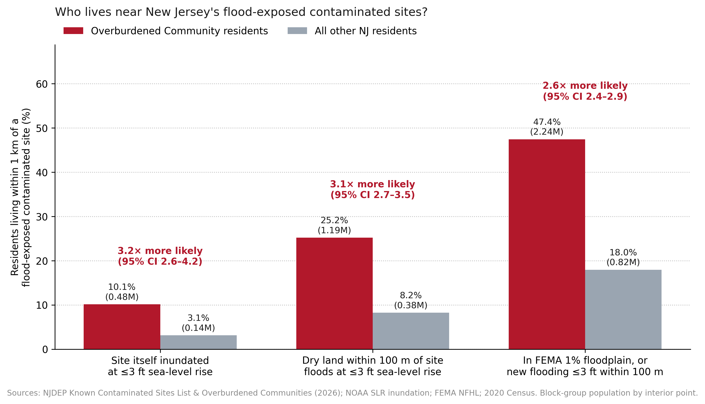
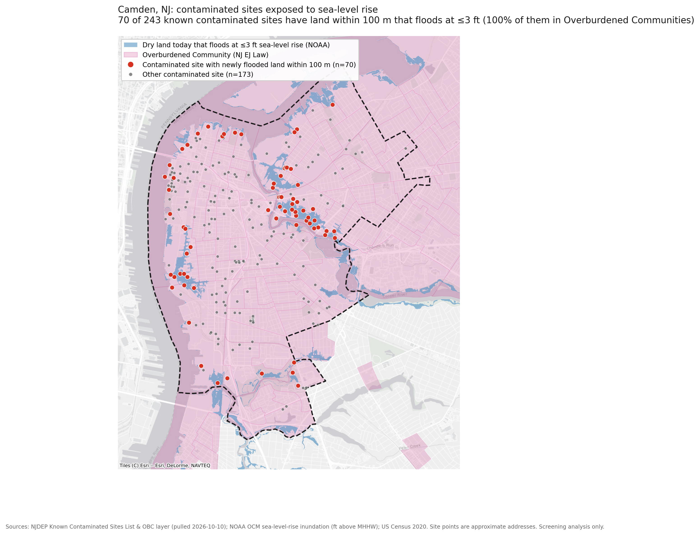

# NJ Toxic Tides

**Which of New Jersey's known contaminated sites are exposed to sea-level rise and coastal flooding, and are overburdened communities disproportionately affected?**

*David Chang, Magnet High School (Class of 2027). Independent research, October 2026. Contact: david.j.chang27@gmail.com*

This is a screening-level analysis. It identifies where flooding and contamination overlap so those places can be investigated further. It does not predict that a specific site will release contamination.

## Results at a glance

- **1,306** of New Jersey's 12,600 known contaminated sites have land within 100 m that is dry today but floods with ≤3 ft of sea-level rise (NOAA). NJ's likely range is 0.9–1.7 ft by 2050, and 2.2–3.8 ft by 2100 under intermediate emissions (NJ Science and Technical Advisory Panel, 2025 report).
- Residents of **Overburdened Communities** (NJ EJ Law) are **3.1×** as likely as other residents to live within 1 km of such a site (95% CI 2.7–3.5): **≈1.19 million people** vs. ≈376,000.
- Comparing sites within the same county, flood-exposed sites are more likely to be in an Overburdened Community (odds ratio **1.78**, 95% CI 1.54–2.05). The disparity appears at 2–3 ft of sea-level rise, not at 1 ft, and not in today's FEMA floodplain.
- **Camden case study:** 70 of 243 sites are exposed, 14 of them starting at 1 ft. 70% of residents live within 1 km of one. See the **[two-page brief (PDF)](outputs/brief_camden/camden_brief.pdf)**.

Full results, corrections, and limitations are in **[outputs/phase2_results.md](outputs/phase2_results.md)**.

| | |
|---|---|
|  |  |

## Pipeline

| Step | Script | What it does |
|---|---|---|
| 1a | `scripts/01_download_njdep.py` | Downloads the NJDEP Known Contaminated Sites List and Overburdened Community block groups |
| 1b | `scripts/02_fema_flood_zones.py` | Looks up the current FEMA flood zone at every site (resumable) |
| 1b+ | `scripts/02b_fema_fallback.py` | Fills sites with no *effective* NFHL coverage (Atlantic and Morris counties) from FEMA's Preliminary/Pending maps. Recorded in `fema_source`. |
| 1c-i | `scripts/03a_prepare_slr.py` | Caches NOAA SLR polygons to GeoParquet (~20 s). Sets GDAL `OGR_ORGANIZE_POLYGONS=CCW_INNER_JUST_AFTER_CW_OUTER`: the default ran >30 min per Southern layer, and the output was verified identical. |
| 1c | `scripts/03_build_site_dataset.py` | Joins sea-level rise, FEMA zone, OBC status, and 2020 population to each site |
| 2a | `scripts/03b_new_inundation_near_sites.py` | **New** inundation near each site: dry-today land within 100/250 m that floods at N ft (grid sampling; excludes today's water) |
| 2b | `scripts/04_disparity_analysis.py` | Site-level odds ratios (crude and county-stratified), sensitivity, population-level ratios, municipality ranking, Figures 1–2 |
| 2c | `scripts/05_maps.py` | Statewide and town maps (Esri gray basemap) |
| 3 | `scripts/06_camden_brief.py` | Two-page Camden policy brief (HTML → PDF via headless Chrome). Every number is computed from the data. |

```bash
python3 -m venv .venv && .venv/bin/pip install numpy pandas geopandas shapely pyogrio pyproj pyarrow requests matplotlib jupyter scipy statsmodels contextily
cd scripts
../.venv/bin/python 01_download_njdep.py
../.venv/bin/python 02_fema_flood_zones.py
../.venv/bin/python 02b_fema_fallback.py
../.venv/bin/python 03a_prepare_slr.py
../.venv/bin/python 03_build_site_dataset.py
../.venv/bin/python 03b_new_inundation_near_sites.py
../.venv/bin/python 04_disparity_analysis.py
../.venv/bin/python 05_maps.py
```

The municipal boundaries for maps come from `curl -O https://www2.census.gov/geo/tiger/TIGER2020/COUSUB/tl_2020_34_cousub.zip`.

NOAA and Census files are downloaded with the `curl` commands listed under each source below.

## Data sources

| Dataset | Publisher | Version used | Notes |
|---|---|---|---|
| Known Contaminated Sites List (KCSL) | NJDEP Site Remediation Program, [REST layer](https://mapsdep.nj.gov/arcgis/rest/services/Features/Environmental_NJEMS/MapServer/0) | Pulled 2026-10-10 (updated daily) | 12,600 sites where soil or groundwater contamination is at or above standards. Includes active sites and sites with completed remediation and ongoing controls. **Many coordinates are approximate "front door" address matches** ([metadata](https://www.nj.gov/dep/gis/digidownload/metadata/html/Envr_NJEMS_KCSL.html)). |
| Overburdened Communities (OBC) | NJDEP, [REST layer](https://mapsdep.nj.gov/arcgis/rest/services/Features/Government/MapServer/42) | Pulled 2026-10-10 | Block groups meeting the NJ EJ Law (N.J.S.A. 13:1D-157) thresholds: ≥35% low-income households, ≥40% minority, or ≥40% limited-English households. |
| Sea-level rise inundation, 0–10 ft | NOAA Office for Coastal Management, [SLR Viewer data](https://coast.noaa.gov/slrdata/) | `NJ_{Northern,Middle,Southern}_slr_data_dist.zip` | Polygons of areas inundated at each 1 ft increment **above Mean Higher High Water (MHHW)**. `slr_Nft` is hydrologically connected to the ocean. `low_Nft` is low-lying but not connected, for example land behind barriers. Static "bathtub" model with no storm surge, erosion, or defenses. |
| Flood hazard zones (NFHL) | FEMA, [REST layer](https://hazards.fema.gov/arcgis/rest/services/public/NFHL/MapServer/28) | Queried 2026-10-10 | Current effective flood zone at each site's point. SFHA = 1% annual-chance floodplain (zones A* and V*). |
| Block groups | US Census TIGER/Line 2020 | `tl_2020_34_bg.zip` | 2020 geography. The OBC layer uses **2010** block groups, so OBC status is assigned spatially (see limitations). |
| Population | 2020 Census P.L. 94-171 redistricting file | `nj2020.pl.zip`, table P1 | Total population per block group. Used for population-weighted baselines. |

```bash
# NOAA (≈70 MB total)
for r in Northern Middle Southern; do curl -O "https://coast.noaa.gov/htdata/Inundation/SLR/SLRdata/NJ/NJ_${r}_slr_data_dist.zip"; done
# Census
curl -O https://www2.census.gov/geo/tiger/TIGER2020/BG/tl_2020_34_bg.zip
curl -O https://www2.census.gov/programs-surveys/decennial/2020/data/01-Redistricting_File--PL_94-171/New_Jersey/nj2020.pl.zip
```

## Known limitations (state these in every write-up)

1. **Point locations are approximate.** A site is a point at its address, not its property boundary. A large industrial parcel can flood even when its address point is dry. Results are therefore also reported with 100 m and 250 m tolerance buffers.
2. **Bathtub inundation.** The NOAA layers show permanent inundation from sea-level rise alone. Storm surge on top of a higher sea level reaches much farther, so these counts are a **lower bound** on flood exposure.
3. **Contamination is not uniform.** The KCSL includes a dry-cleaner groundwater plume and a Superfund chemical plant alike. Remediation level (`REM_LEVEL`), status, and NPL flags are kept so results can be broken down.
4. **Datum mismatch.** NOAA levels are feet above MHHW (1983–2001 tidal epoch). NJ's projections (2025 STAP report) are relative to a 1995–2014 baseline centered on 2005. The offset is a few inches, so matching the 1/2/3 ft levels to projection years is approximate.
5. **OBC geography is 2010-based.** 472 OBC GEOIDs do not exist in 2020 geography. Sites are flagged OBC if their point falls inside an OBC polygon. 2020 block groups are flagged OBC if their interior point does, which gives 3,314 block groups and 50.9% of the 2020 population, consistent with NJDEP's "about half of NJ residents".
6. **FEMA coverage gap.** FEMA's public effective NFHL service has no flood-zone polygons for most of Atlantic County (including Atlantic City) and Morris County. For 793 sites there, the flood zone comes from FEMA's **preliminary** maps, which are not yet legally effective. Report these separately or label them.
7. **NOAA layers include today's water.** Every level (0–10 ft) contains current tidal water, so "within X m of inundation" must exclude the 0 ft extent. Otherwise every waterfront site counts as exposed. Use `new_inund_ft_within_*`, not `slr_ft_connected_within_*`, for exposure. The latter is kept only to document the error.
8. **Related work.** Cushing et al. (2023, *Environmental Science & Technology*) did this analysis for coastal California. This project adapts the approach to NJ's own contaminated-site inventory and its OBC law.

## Outputs (Phase 1)

- `data/processed/kcsl_sites_enriched.{gpkg,csv}`: one row per site. Key columns:
  - `slr_ft_connected`: lowest NOAA level (0–10 ft above MHHW) that inundates the site point. NaN means none.
  - `slr_ft_connected_within_100m`, `slr_ft_connected_within_250m`: the same, with a tolerance buffer.
  - `slr_ft_lowlying`: lowest level at which the point is in an unconnected low-lying area.
  - `fema_zone`, `fema_sfha`, `fema_source` (`effective` / `preliminary`).
  - `is_obc`, `obc_criteria`, `bg_geoid`, `bg_pop_2020`.
  - `new_inund_ft_within_{100m,250m}`, `frac_new_inund_3ft_{100m,250m}`: Phase 2 exposure measures (preferred).
- `data/processed/block_groups_2020.gpkg`: all 6,599 NJ block groups with `pop_2020` and `is_obc`.
- `data/processed/noaa_slr_{slr,low}.parquet`: cached inundation polygons.

## Phase 2 results

See **[outputs/phase2_results.md](outputs/phase2_results.md)**. Headline: OBC residents are about 3× as likely to live within 1 km of a contaminated site threatened by ≤3 ft of sea-level rise (3.06, 95% CI 2.67–3.54). Figures and tables are in `outputs/`.
